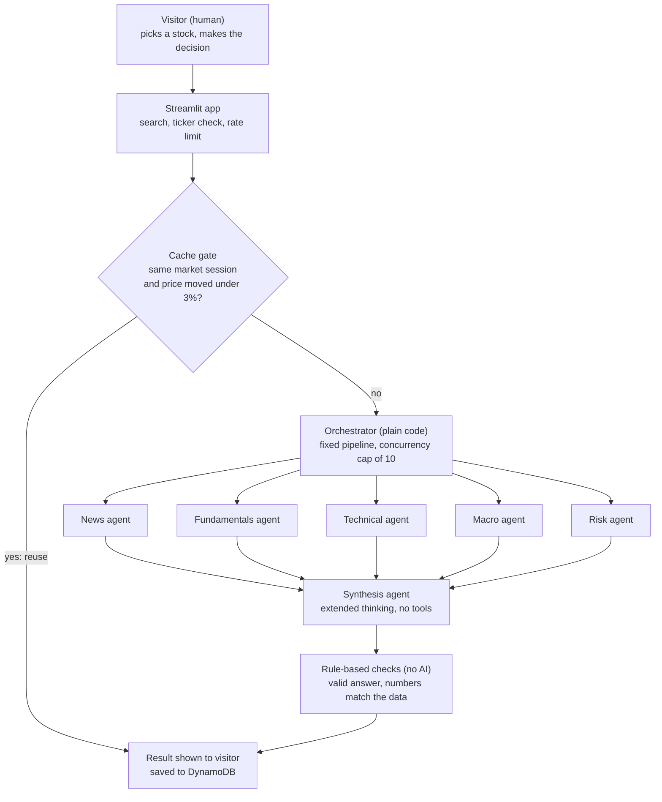

# TradeDesk: Multi-Agent Equity Research

> Five AI research agents study a stock in parallel, a lead agent resolves their disagreements, and rule-based checks verify the answer before anyone sees it. Built on Claude via AWS Bedrock.

**Status: live and publicly deployed.**

This is a research and educational tool, not financial advice. Nothing here should be the sole basis for a trade. Consult a qualified financial adviser before making any investment decision.

---

## Live Demo

**[Launch TradeDesk](https://tradedesk-svd009.streamlit.app/)**

Supports **US stocks** (for example `AAPL`, `NVDA`) and **Indian stocks on NSE/BSE** (for example `RELIANCE.NS`, `TCS.BO`). Search by company name across 5,786 listed companies, or type a ticker directly.

---

## What It Does

Search a company, and five specialized agents research it at the same time: news sentiment, fundamentals, technicals, macro and sector context, and portfolio risk. A synthesis agent reads all five findings, works out where they conflict, and returns one recommendation (BUY, HOLD or SELL) with a confidence level, a bull case, a bear case, key risks and catalysts to watch.

Around the AI sits ordinary code that does the parts a model should not be trusted with: fetching and computing every number, checking the data is sane, validating the final answer, and controlling cost.

The app has four pages:

| Page | What it shows |
| --- | --- |
| Single Stock | Full analysis, live price chart, rule-based scorecard, peer comparison |
| Portfolio | The same analysis across a set of holdings, with portfolio-level risk |
| Screener | Filter the stock universe by valuation, growth, momentum and dividends |
| Track Record | How past recommendations compare with what the price did next |

---

## Architecture



| Layer | Model or technology | Role |
| --- | --- | --- |
| Research agents (5) | Claude Haiku 4.5 | Narrow, tool-using tasks, run in parallel with a 45-second budget |
| Synthesis agent (1) | Claude Sonnet 4.6, extended thinking | Weighs the five findings and makes the call |
| Orchestration | Python | Fixed steps in code; the models never choose the control flow |
| Storage | Amazon DynamoDB | Cached analyses, usage and cost totals, screener rows, user reports |
| Front end | Streamlit | Pages, charts, forms |

The design pattern is **orchestrator-workers** (fan out, then fan in). It is a workflow, not an autonomous agent: the code decides what runs and in what order, and the models do the reasoning inside each step.

### Which agent uses which tool

| Agent | Tools | Data source |
| --- | --- | --- |
| News | `search_market_news` | Tavily live search |
| Fundamentals | `get_fundamentals`, `get_sec_filings` | Yahoo Finance, SEC EDGAR |
| Technical | `get_price_and_technicals` | Yahoo Finance, Twelve Data fallback |
| Macro | `get_sector_comparison`, `search_market_news` | Sector ETFs, Tavily |
| Risk | `get_portfolio_exposure`, `get_fundamentals` | The visitor's holdings (Portfolio mode) |

Each agent can call only its own tools, for at most six turns, after which a final answer is forced.

---

## Where the Models Run: AWS Bedrock

All model calls go through the Bedrock Converse API using US inference profiles. One client (`src/client/model_client.py`) hides the provider, so agents call the same interface whether the backend is Bedrock or the Anthropic API.

The client detects the model generation from its ID and sends the right thinking settings for each, so upgrading models is a configuration change:

```
BEDROCK_MODEL_FAST=us.anthropic.claude-haiku-4-5-20251001-v1:0
BEDROCK_MODEL_REASONING=us.anthropic.claude-sonnet-4-6
```

Run `python check_bedrock.py` to confirm model access and the DynamoDB table before deploying.

---

## Real Data, Not Model Guesswork

- **Every number comes from code.** Prices, support and resistance, the 200-day average and RSI are computed from price history. Values the technical agent reports are overwritten with the computed ones before synthesis and before display.
- **Standard indicators.** RSI uses Wilder smoothing and MACD uses a true 9-period signal line, both verified against reference implementations.
- **Resilient data fetching.** Yahoo Finance calls retry three times; price history then falls back to Twelve Data. Errors are never cached, and a reference-ticker check tells a bad ticker apart from a data outage.
- **SEC filings** come from EDGAR's company submissions feed, with annual and quarterly reporting checked against expected schedules.
- **Rule-based scorecard.** Performance, valuation, growth and profitability are scored 0 to 10 by deterministic rules, shown next to the AI's view.

---

## Guardrails

Checks run at every stage, and none of them use AI.

| Stage | Check | On failure |
| --- | --- | --- |
| Before any model call | Ticker exists, rate limit, concurrency cap | Rejected at near-zero cost |
| Each agent | Own tools only, 6 turns, 45 seconds, JSON object required | Agent marked failed; the rest continue |
| Tool results | News results labelled as untrusted text | Models are told never to follow instructions inside them |
| Before synthesis | Price above zero and not stale, plausible margins, two price sources agree | Warning passed to synthesis; result flagged |
| After synthesis | Valid label, confidence in range, call agrees with score | Repaired or flagged; an unreadable answer is retried once, then reported as an error |
| After synthesis | Every number in the summary must exist in the input data | Result flagged for review |

Visitors can report a result through a "Something look wrong?" form under each analysis. Reports and automatically flagged results are listed by `scripts/admin_report.py`.

---

## Cache and Traffic Controls

- **Market-session cache.** A saved analysis is reused only within the session it was made in: before the open, morning, afternoon, or after the close. US and Indian markets each follow their own hours. A visitor at 2 PM never sees a 6 AM analysis.
- **Price-move refresh.** If the price has moved 3% or more since the saved analysis, it is redone regardless of the session.
- **Live prices.** The chart and price levels are always computed from fresh data and are never part of the cached result.
- **Stampede protection.** A per-stock lock means several simultaneous requests for the same new stock trigger one analysis.
- **Token-bucket rate limiter.** Five analyses per visitor session, refilling one every ten minutes.
- **Concurrency cap.** At most ten fresh analyses run at once across all visitors. Cached results are never blocked by it.

---

## Cost Tracking

Token counts returned by Bedrock are recorded for every model call, summed per analysis, and stored with running totals in DynamoDB. A fresh analysis costs roughly $0.10 to $0.15; a cached one costs nothing in model spend.

```
python scripts/admin_report.py
```

prints total tokens, total cost, average cost per analysis, flagged results and user reports.

---

## Track Record

Every recommendation is stored with the price at the time it was made. After seven days it is judged against what the price did, and the Track Record page shows the hit rate and whether stated confidence matches real outcomes.

Persistent storage went live in November 2026, so the record is still building. Treat the accuracy figures as early until a few months of history exist.

---

## Known Limitations

- Accuracy of the recommendations is not yet proven; the Track Record needs time.
- The quality score checks the form of an answer, not whether it was right. A fixed evaluation set is the next planned addition.
- The rate limiter, concurrency cap and locks live in one process, which suits a single server.
- Yahoo Finance is an unofficial data source with no service guarantee.
- Public holidays are not modelled in the cache windows.
- India coverage is the Nifty 50; US coverage is the full listed universe.

---

## Quick Start

```bash
git clone https://github.com/svd009/tradedesk.git
cd tradedesk
pip install -r requirements.txt
cp .env.example .env        # then fill in your values
python check_bedrock.py     # confirms models and table are reachable
streamlit run app.py
```

Settings in `.env`:

| Variable | Purpose |
| --- | --- |
| `AWS_ACCESS_KEY_ID`, `AWS_SECRET_ACCESS_KEY` | IAM user with Bedrock and DynamoDB access |
| `AWS_REGION` | Region of the DynamoDB table and model calls (default `us-east-1`) |
| `BEDROCK_MODEL_FAST`, `BEDROCK_MODEL_REASONING` | Model IDs for the agents and for synthesis |
| `DYNAMODB_TABLE_NAME` | Defaults to `tradedesk_analyses` |
| `FAIL_ON_STORAGE_ERROR` | `true` stops on a storage failure; `false` falls back to memory |
| `TAVILY_API_KEY` | Live news search |
| `TWELVE_DATA_API_KEY` | Optional price-history fallback and price cross-check |

The DynamoDB table must exist before the app starts: partition key `ticker` (String), sort key `window_sig` (String).

### Docker

```bash
docker build -t tradedesk .
docker run -p 8501:8501 --env-file .env tradedesk
```

---

## Continuous Integration

GitHub Actions compiles every Python file on each push (`.github/workflows/ci.yml`). A second workflow (`screener-snapshot.yml`) builds the Screener's daily snapshot on a schedule, outside the web app, so visitors never wait on it.

---

## Project Structure

```
tradedesk/
├── app.py                          Streamlit app: pages, charts, forms
├── config.py                       All settings, read from the environment
├── check_bedrock.py                Pre-deploy check of models and table
├── Dockerfile
├── scripts/
│   ├── admin_report.py             Cost, flagged results, user reports
│   └── build_screener_snapshot.py  Daily Screener build (run by CI)
└── src/
    ├── client/model_client.py      One interface for Bedrock or Anthropic
    ├── subagents/                  Base agent (tool loop) and the five agents
    ├── mcp_server/market_tools.py  The tools agents may call
    ├── data/                       Market data, indicators, filings, scorecard
    ├── orchestrator/
    │   ├── tradedesk_orchestrator.py   The fixed pipeline
    │   ├── parallel_runner.py          Thread pool with a time budget
    │   ├── synthesis_agent.py          The lead agent
    │   ├── analysis_cache.py           Session windows, locks, concurrency
    │   ├── rate_limiter.py             Token bucket
    │   ├── storage.py                  DynamoDB
    │   ├── accuracy_tracker.py         Track Record maths
    │   └── screener.py
    └── evaluation/
        ├── guardrails.py           Data, output and grounding checks
        └── eval_framework.py       Rule-based quality score
```

---

## Built With

Python, Streamlit, Plotly, AWS Bedrock (Claude Haiku 4.5 and Claude Sonnet 4.6), Amazon DynamoDB, boto3, yfinance, Twelve Data, SEC EDGAR, Tavily, GitHub Actions, Docker.
